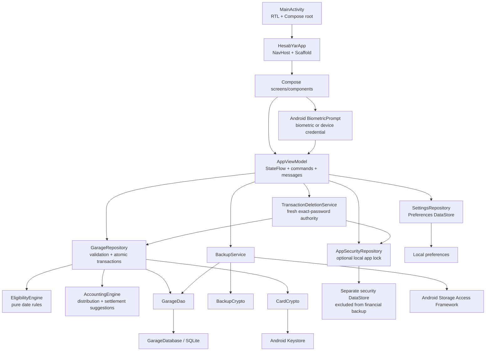
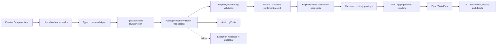
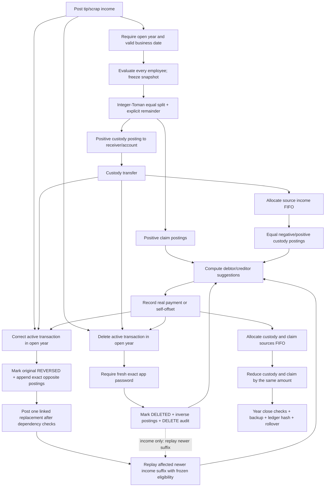

# AGENTS.md — HesabYar Garage Engineering Guide

This file is the pre-change reference for Codex, Claude, Cursor, and other development agents. It describes the repository as it actually exists at the reviewed baseline below. Read it before changing code, database schemas, tests, build configuration, documentation, or release automation.

## Reviewed baseline and source-of-truth order

- Baseline commit reviewed: `main` at `44f3038`; version 1.4.1 was verified on top of the signed 1.4.0 source at `f4b77af`, and this guide was refreshed on 2026-07-18.
- Code Review Graph 2.3.6 verified 1.4.1 snapshot: 866 nodes, 10,717 edges, 67 parsed Kotlin/Bash files.
- Graph registry/watcher alias: `project-name`.
- Evidence priority when sources disagree: executable code and exported Room schema, then tests, then build/workflow configuration, then repository documentation, then this file.
- Do not invent a convention or architectural rule. If the repository does not provide evidence, state that the behavior is unspecified.
- Update this file in the same change whenever architecture, financial invariants, persistence, verification, or release behavior changes.

## Mandatory pre-change protocol

1. Read this file and inspect `git status --short --branch`. Preserve all user changes and do not rewrite unrelated files.
2. Run `code-review-graph status`. If it is empty or stale for the checked-out source, run `code-review-graph build` before impact analysis.
3. Use the graph plus direct source inspection to identify callers, persistence/backup impact, tests, and release/documentation impact. The graph supplements the code; it does not replace reading sensitive flows.
4. For a financial mutation, write down its effect on claims, custody, source allocations, remainder, and closed-year rules before editing.
5. Make the smallest coherent change. Never weaken repository validation merely to enable a UI control.
6. Verify in proportion to risk using the commands in this file. UI changes require RTL visual inspection; persistence changes require device/instrumentation coverage.
7. Review the final diff for credentials, signing material, real card numbers, personal workshop data, build output, and unintended schema changes.

The Code Review Graph integration for Codex is installed without generated instructions. The supported project setup commands are:

```text
code-review-graph install --platform codex --dry-run
code-review-graph install --platform codex --no-instructions
code-review-graph build
code-review-graph status
code-review-graph register . --alias project-name
code-review-graph daemon add . --alias project-name
```

`.code-review-graph/` is generated local metadata and must remain ignored by Git.

## Product and system boundary

HesabYar Garage is a single-module, offline-first Persian Android application for personnel periods/absences, shared tip and scrap-income accounting, custody transfers, settlements, auditable transaction corrections and deletions, optional local app locking, encrypted backup/restore, and Solar Hijri financial-year close.

There is no backend, HTTP API, server, cloud database, authentication service, payment gateway, order system, queue, Docker runtime, Firebase integration, analytics SDK, or advertising SDK in this repository. `AndroidManifest.xml` requests no Internet permission and defines only the launcher activity. Do not introduce network behavior or a cloud dependency without explicit product approval and a privacy/security review.

## Technology inventory

| Area | Actual technology |
| --- | --- |
| Platform/language | Android; Kotlin 2.3.21; Java/JVM 17 |
| UI | Jetpack Compose; Material 3; extended Material icons; forced RTL root layout |
| Navigation | Navigation Compose 2.9.3 with string routes in `HesabYarApp.kt` |
| State | One `AppViewModel`; Kotlin Coroutines, `Flow`, `StateFlow`, `SharedFlow` |
| Dependency wiring | Manual `AppContainer` in `HesabYarApplication.kt` |
| Persistence/ORM | Room 2.8.4 over local SQLite; exported schemas; database version 4 with explicit `1 -> 2 -> 3 -> 4` migrations |
| Preferences | AndroidX Preferences DataStore 1.2.1 |
| Security | Android Keystore AES-GCM for stored cards; PBKDF2/AES-GCM and SHA-256 for portable backups; optional PBKDF2 app lock and AndroidX BiometricPrompt/device credential |
| Build | Gradle wrapper 8.13; Android Gradle Plugin 8.13.2; KSP 2.3.9 |
| Android targets | `minSdk 26`, `targetSdk 36`, `compileSdk 36` |
| Unit tests | JUnit 4, coroutines-test, Room testing |
| Device/UI tests | AndroidX Test, Espresso, Compose UI test |
| CI | GitHub Actions on `ubuntu-latest`, JDK 17 |
| Delivery | Private signed candidate workflow, exact-file Play Protect approval, then GitHub Release on semantic version tag push |

Dependency versions are declared directly in root and app Gradle Kotlin files; there is no version catalog at the baseline.

## Repository map

```text
app/
  build.gradle.kts                 Android, signing, dependencies, Room schema export
  schemas/.../{1,2,3,4}.json       checked-in Room schemas and migration contract
  src/main/
    AndroidManifest.xml            app/process and permission boundary
    java/com/hesabyar/garage/
      HesabYarApplication.kt       process entry and manual dependency container
      MainActivity.kt              Compose root, RTL, ViewModel creation
      ui/                           screens, navigation, shared ViewModel
      ui/components/                reusable form/display composables
      ui/theme/                     Material theme
      domain/                       pure accounting and eligibility rules/models
      data/                         repository, settings, backup orchestration
      data/local/                   Room entities, DAO, converters, database
      security/                     card and backup cryptography
      util/                         Solar Hijri dates, formatting and validation
  src/test/                         JVM tests
  src/androidTest/                  Room/Keystore and Compose device tests
.github/workflows/                  CI and signed release automation
docs/                               accounting, test, release and audit documentation
  release/<version>/                  version-scoped notes, install/audit records, screenshots, store assets; APKs ignored recursively
```

## Architecture and component graph

The implemented architecture is pragmatic layered MVVM: Compose screens consume observable ViewModel state and submit command objects; the ViewModel delegates to a repository; the repository validates and performs atomic Room transactions; pure domain engines own deterministic accounting/eligibility calculations. `AppContainer` is manual dependency injection.



Patterns demonstrated by code:

- Repository/transaction script around Room mutations.
- Command objects with UUID `commandId` checks for idempotent income, transfer, and settlement posting.
- Append-only claim and custody ledgers rather than editing computed balances.
- Append-only financial correction: reverse the selected active version and, for an older income, atomically reverse and replay the affected newer logical suffix while preserving frozen eligibility decisions.
- Append-only financial deletion through `TransactionDeletionService`: require a fresh exact app-password check, append inverse postings, mark the active record `DELETED`, and retain its reason and `DELETE` audit.
- Immutable eligibility snapshots captured at income-post time.
- FIFO source allocation connecting later movements to original income events.
- Manual dependency injection rather than Hilt/Koin/Dagger.
- Read models/DAO projections for balances, history, custody, and income rows.
- A fail-closed app-access gate outside the financial `NavHost`; app content is not composed until security state has loaded and the current process session is unlocked.

## Data-flow graph



`AppViewModel` converts repository failures to Persian Snackbar messages with `runCatching` and exposes a busy overlay. Domain correctness must remain enforced in the repository even when the UI pre-validates the same condition.

## Critical financial flows



### Accounting invariants

These rules are enforced by `AccountingEngine.kt`, `EligibilityEngine.kt`, `GarageRepository.kt`, DAO queries, tests, and repository documentation:

- Store money as integer Tomans in `Long`. Never use `Float`, `Double`, or implicit currency conversion.
- Employment start/end days are inclusive. A recorded return day is present.
- The absence grace period is configurable from 0 to 365 days and defaults to 14. The current value applies only when previewing or posting a new income; the recorded return day is present.
- Each employee has a `sharedIncomeEligible` switch. When false, new tip and scrap events freeze a `SHARED_INCOME_DISABLED` snapshot and create no entitlement for that employee, but the employee remains a valid receiver, holder, transfer party, and settlement party for shared money.
- Changing the employee switch affects only future postings. It must never recalculate an existing eligibility snapshot, claim, custody posting, or closed year.
- Do not retroactively recalculate a posted income event's eligibility snapshot.
- Claims, custody, transfers, settlements, remainders, and source allocations are distinct concepts and records.
- A custody transfer changes the holder/account only; it must not create/destroy money or settle a claim.
- A settlement reduces the selected claim and custody positions by exactly the same amount.
- Allocate partial custody and settlement sources FIFO back to original income events.
- Financial history is append-only in normal operation. Do not hard-delete posted financial records.
- Editing a posted income, custody transfer, or settlement means an atomic correction, never an in-place rewrite: the original becomes `REVERSED`, opposite postings cancel its ledger effect, the replacement links through `replaces*`, and the audit reason remains visible. Only an open year can be corrected.
- An active income may be corrected in any order. The repository finds its logical correction lineage, reverses the selected income and newer active suffix from newest to oldest, posts the selected replacement, and replays newer incomes in logical order. Replayed eligibility statuses and reasons remain frozen; only integer shares, carried/resulting remainder, and ledger postings are recalculated. A real active transfer or settlement allocation anywhere in the affected suffix still blocks the operation until that dependency is changed or deleted.
- Deleting an active income, custody transfer, or settlement is an atomic append-only financial mutation, never a hard delete. It is allowed only in an open year, marks the record `DELETED`, appends exact inverse postings, records the reason in a `DELETE` audit, and excludes the record from active balances while retaining it in history. Income deletion replays its newer logical suffix under the same frozen-snapshot rules.
- Every deletion requires app locking to be configured and a fresh exact app-password verification. An unlocked session, biometric result, or device credential is not a substitute. Raw repository deletion methods remain internal and require the identity-bound authority held by `TransactionDeletionService`.
- Transfer correction/deletion requires the destination still to hold every allocated source; all corrections/deletions must leave account, person, claim-source, custody-source, and remainder balances non-negative and preserve `claims + remainder == custody`.
- POS is a real-world income receipt method only. It creates/reuses a holder-level POS custody account but never connects to a terminal, bank, network, or payment processor; transfer and settlement methods remain cash/card.
- A closed year is immutable. Closing requires the year to have ended, claims settled, custody reduced to the explicit remainder, and a final backup newer than the last audit mutation.
- Rollover must zero the closing year and preserve the explicit remainder and its custody source in the next year.

### Other sensitive flows

- **App access:** there is no account, identity, backend authentication, or authorization model. An optional device-local app lock is disabled by default. Its password/recovery verifiers and throttle live in a separate DataStore excluded from financial backups. Optional Android `BiometricPrompt`/device credential returns only a success/failure result; never describe it as proving a person's identity or claim access to biometric/device-secret data. Transaction deletion is the exception that always requires a fresh exact app-password check through `TransactionDeletionService`; repository deletion authority is internal/identity-bound and the password `CharArray` must be cleared after every attempt.
- **Payment:** income receipt records `CASH`, `CARD`, or income-only `POS`; custody transfer and settlement record only `CASH` or `CARD`. These are records of real-world movement, not a card processor or bank integration.
- **Orders:** no order/work-order model exists.
- **Database:** Room is the authoritative business store. Foreign keys use `RESTRICT`, and mutations are wrapped in `database.withTransaction`.
- **File import/export:** backup and restore use Android Storage Access Framework; there is no upload to a server. Restore is a full transactional replacement and must preserve encryption/compatibility.
- **Permissions:** the manifest has no runtime or Internet permissions. File access comes through user-selected SAF URIs.
- **Card data:** permanent account card numbers and optional per-movement card numbers are encrypted with Android Keystore, masked by default, and included in password-encrypted backups. A nonblank card number is normalized and checksum-validated; a blank number is valid even when the method is `CARD`.

## Persistence and backup contract

The Room model is highly coupled to ledger and backup behavior:

- `MoneyAccountEntity` is both a cash/card/POS description and the account-level custody bucket referenced by postings and FIFO queries.
- `AccountType.POS` is an internal holder-level custody bucket for income received through a physical terminal. POS records no customer card and has no network integration.
- `IncomeEventEntity` stores the explicit money method and optional encrypted card/date/time movement metadata; its ledger receiver account is resolved internally and does not require a card saved on the employee profile.
- `CustodyTransferEntity` requires source custody, stores an explicit destination employee/method, and supports optional encrypted card/date/time movement metadata. The repository resolves a reusable cash or generic card custody account when needed.
- `SettlementPaymentEntity` requires a source custody account, stores the explicit method, and supports optional encrypted card/date/time movement metadata; destination account remains nullable.
- `IncomeEventEntity.replacesEventId`, `CustodyTransferEntity.replacesTransferId`, and `SettlementPaymentEntity.replacesPaymentId` are nullable, uniquely indexed links from an active correction to its immediately previous version. They are audit links, not cascade foreign keys.
- `CustodyPostingEntity.accountId` drives account balances and source allocation queries.
- `BackupService` serializes all tables, has explicit reflection field contracts, decrypts/re-encrypts stored card data for portable backup, and restores tables in dependency order.

`GarageDatabase` remains version 4; `DELETED` is stored in the existing text status columns, so 1.4.1 introduces no DDL change or Room migration. `MIGRATION_1_2` adds optional per-movement card/date/time metadata; `MIGRATION_2_3` adds `EmployeeEntity.sharedIncomeEligible` with a default of true for every existing employee; `MIGRATION_3_4` adds nullable transfer/settlement replacement links and unique replacement indexes without rewriting existing rows. Backup schema 6 stores `DELETED` transaction states and retained deletion audit data together with POS values and correction links, accepts schemas 1 through 6, and preserves the existing backward-compatible defaults. App-lock DataStore is deliberately not serialized. Any further persistent field/table/index/foreign-key change must include all of the following in the same change:

1. Increase the Room database version and add an explicit migration; never use destructive migration.
2. Update the exported schema under `app/schemas/`.
3. Add a migration/instrumentation test proving existing ledger and card data survive.
4. Update `BackupService` serialization, reflection contracts, restore order, and backward-compatibility handling.
5. Update affected DAO projections/queries and financial invariant tests.
6. Document the schema/backup compatibility impact.

Do not remove or repurpose historical account rows that are referenced by financial foreign keys.

## Navigation map and UI rules

`HesabYarApp.kt` is the route source of truth.

- Top-level routes: `home`, `people`, `income`, `settlement`, `more`.
- Nested routes: employee add/detail/edit, absence add/edit, employment add/edit, and card add; transfer add/detail/correct; income detail/correct; settlement detail/correct; app security; annual history, close, and privacy policy.
- After onboarding, the bottom bar remains visible on top-level and nested routes; a nested route selects its parent tab.
- Tapping Home from any route pops to the existing Home destination and emits a new scroll request. Tapping Home while already there emits the same request, so the dashboard animates to its first item every time.
- Tapping the current parent tab from a nested route pops to that tab root. Cross-tab navigation uses saved state, single-top, state restoration, and a start-destination `popUpTo` plan centralized in `TopLevelNavigationPlan`.
- Dashboard scroll state is controlled by `rememberLazyListState`; navigation changes must preserve the explicit reselection, back-stack, and scroll-to-top contract and its tests.

UI requirements demonstrated by the repository:

- All user-facing copy is Persian and the entire Compose tree is RTL.
- Keep Material 3 components, existing rounded-card visual language, Persian digit/money helpers, and Solar Hijri date controls.
- Use shared primitives from `ui/components/Common.kt` instead of duplicating common fields/buttons/headers.
- UI validation controls affordance, while repository validation controls correctness.
- Visible UI changes require RTL screenshots or equivalent visual QA on an emulator/device.
- The Persian privacy policy must remain accessible before onboarding data is saved and later from the More section; update both in-app and repository policy text whenever data handling changes.
- Developer-contact actions may launch Bale or Telegram through explicit external `ACTION_VIEW` intents, but must not add Internet permission or attach workshop/personnel/financial data to the link.
- Lazy list items with mixed sections require stable, globally unique keys; preserve the section-prefix approach used by personnel detail.
- Dashboard balance and income rows share one `LazyColumn`; their keys must remain prefixed by section (`balance:` and `income:`) because independent Room tables can produce the same numeric ID.
- User-facing copy must distinguish personal entitlement from “پول مشترک نزد فرد”. Never relabel current custody as personal receipt. A zero net is settled only when both claim and custody are zero; equal positive values still require a self-offset.
- App lock and device unlock are independently optional. Never render or compose onboarding/financial navigation while security state is loading or the current session is locked. Keep the navigation controller outside the access gate so the route survives a background lock; do not leak protected content through Android Recents.
- Passwords accept exact Unicode including Persian and are never silently normalized. Recovery answers intentionally normalize common Persian/Arabic `ی/ي`, `ک/ك`, Persian/Arabic digits, whitespace, and ZWNJ. Security-question recovery is weaker than a random recovery code; keep the warning and persistent throttling, and never add data wipe on failed attempts.
- Deletion confirmation requires a reason and the exact app password on every attempt. If app locking is disabled, route the user to app security. Disable fields, dismissal, and duplicate submission while verification/mutation is in flight. Deleted records remain visibly marked «حذف‌شده • بدون اثر در حساب» with their retained reason.
- Replacement detail screens must expose the previous version and correction reason. Reversed versions are clearly marked as inactive; current transaction/year history lists `POSTED` and `DELETED` versions while append-only ledger/audit records remain queryable. Active balance/dashboard queries remain `POSTED`-only.

## Coupling, hotspots, and risk areas

- `GarageRepository.kt` is the central mutation and invariant hotspot; changes can affect Room, backup, balances, close-year behavior, and many screens.
- `Entities.kt`, `GarageDao.kt`, the exported schema, and `BackupService.kt` form one persistence compatibility unit.
- `AppSecurityRepository.kt`, `CredentialHasher.kt`, `DeviceAuthenticationGateway.kt`, `TransactionDeletionService.kt`, the repository's identity-bound deletion authority, the access gate in `HesabYarApp.kt`, and lifecycle session state in `AppViewModel.kt` form one security boundary. Financial backup/restore must never overwrite or export this security DataStore.
- DAO active calculations remain `POSTED`-only. Transaction and annual history queries intentionally include `POSTED` and `DELETED`; changing either filter can silently corrupt totals or erase the visible audit trail.
- `MoneyAccountEntity` remains the ledger custody bucket, while the real-world payment method/card/time belongs to each movement entity. Do not remove the internally resolved cash/generic-card account layer: custody postings still require an account foreign key.
- Route strings and bottom-navigation logic are centralized in `HesabYarApp.kt`, but individual screens own scroll state and back actions.
- `AppViewModel` is a single application-level façade; adding direct DAO or repository access in Composables would break the established boundary.
- Financial year and business date are not display-only metadata: they govern eligibility, query partitioning, source ordering, immutability, and close rules.
- Backup restore uses reflection/explicit field lists; entity edits can compile while silently breaking backup unless its contract test is updated.
- Local `assembleRelease` remains unsigned when permanent signing environment variables are absent. Public artifacts must use `assemblePublicRelease`, the permanent key, and the pinned certificate SHA-256 fingerprint; changing that key breaks in-place updates.

## Naming, files, and module communication

Observed conventions:

- Kotlin packages and route names are lowercase; types are `PascalCase`; functions/properties are `camelCase`.
- Persistent models use `*Entity`; mutation inputs use `*Command`; screens use `*Screen`; pure rule modules use `*Engine`; repository/UI row projections use descriptive `*Row`/`*Data` names.
- DAO observable queries generally use `observe*`; point-in-time database access is `suspend` and uses entity/descriptive names.
- Indent Kotlin/KTS with 4 spaces and JSON/YAML with 2 spaces. Use UTF-8, LF, a final newline, and no trailing whitespace except where Markdown requires it (`.editorconfig`).
- Keep new code in the existing layer/package. A Composable must communicate through `AppViewModel`; the ViewModel through repositories/services; repositories through DAOs/domain engines.
- Prefer a focused file near related behavior. Extract shared UI into `ui/components`, deterministic business rules into `domain`, persistence into `data/local`, orchestration into `data`, and crypto into `security`.
- Do not introduce a new architectural framework or dependency injection library for an isolated feature.

## Error handling and validation

- Validate domain inputs with `require`/`error` inside repository transactions and use clear Persian messages.
- Use `Math.addExact`, `Math.subtractExact`, and `Math.toIntExact` where overflow would corrupt financial/date behavior.
- The ViewModel's `launchAction`/`launchSilent` wrappers own busy state and user-visible Snackbar failures.
- Do not catch and discard repository exceptions in UI code.
- UI fields use button `enabled`, `isError`, and supporting text for fast feedback, but these checks are not a substitute for repository constraints.
- Keep multi-table mutations atomic and add an audit record for material state changes.

## Verification matrix

Run from the repository root. On Windows PowerShell use `gradlew.bat`.

Fast required verification for a normal change:

```powershell
.\gradlew.bat testDebugUnitTest lintDebug assembleDebugAndroidTest
```

CI-equivalent build verification:

```powershell
.\gradlew.bat testDebugUnitTest lintDebug assembleDebugAndroidTest assembleRelease --stacktrace
```

Full clean verification and connected device tests:

```powershell
.\gradlew.bat clean testDebugUnitTest lintDebug assembleDebugAndroidTest assembleRelease
.\gradlew.bat connectedDebugAndroidTest
```

Change-specific expectations:

| Change | Required evidence |
| --- | --- |
| Pure domain/accounting/date | JVM boundary and invariant tests |
| Repository/ledger mutation | JVM tests plus Room instrumentation; verify balances and FIFO sources |
| Entity/DAO/schema/backup | Migration test, exported schema, backup round-trip/contract tests, connected instrumentation |
| Card handling/crypto | Validator/crypto tests; masking; encrypted backup/restore; no secrets in logs or fixtures |
| Compose/navigation | Compile, lint, Compose/device behavior test where practical, RTL visual QA |
| Build/release | CI-equivalent assemble, APK signature/hash checks, release-document update |

Existing test areas include accounting distribution/suggestions, configurable and per-person eligibility boundaries, Solar Hijri conversion/input, movement-time parsing, card validation, backup crypto/reflection contracts, personnel/dashboard list-key safety, top-level navigation planning, Room migration/Keystore integration, movement-method ledger invariants, dashboard scroll-to-top, and Compose Persian-date/personnel-control behavior.

The 1.4.0 suites additionally cover fail-closed app-access resolution and timeout boundaries, salted exact-Unicode password verification, Persian recovery normalization, recovery-code rotation, persistent throttling, security-DataStore independence from every Room table, POS custody, atomic correction rollback, linked replacement ledgers, source-date/FIFO guards, Room `3 -> 4`, and backup schema 5 round-trip.

The 1.4.1 suites additionally cover repeated newest/middle/oldest income correction, logical suffix replay with frozen eligibility snapshots, dependency rejection and atomic rollback, append-only income/transfer/settlement deletion, active-total exclusion and retained history/audit, closed-year guards, exact-password/no-lock/wrong-password enforcement, internal deletion authority, retry/duplicate-submit UI behavior, backup schema 6 round-trip, and legacy schema 4/5 restore.

## Infrastructure, Git, and release workflow

- Work from a focused branch based on `main`. Examples in the repository use `feat/...` and `fix/...`.
- Commit messages follow Conventional Commits (`feat:`, `fix:`, `test:`, `docs:`, `refactor:`, `chore:`).
- Every completed repository change must end with one or more coherent Conventional Commits after verification and final diff review. Use the repository owner's configured Git author/committer identity, never add AI/tool/co-author trailers, and do not leave the requested implementation only in the working tree.
- Keep commits coherent. Do not commit generated build output, `.code-review-graph/`, local SDK settings, APK/AAB binaries, credentials, signing stores, or real personal/card data.
- Organize local release material under `release/v<version>/`; keep notes, install instructions, release records, checksums, screenshots, GitHub material, and store-specific material beside the version they describe. Do not leave a stale `latest.apk` in the repository tree; the publishing workflow creates that alias in its temporary `dist/` directory.
- CI runs on pushes to `main` and pull requests via `.github/workflows/android-ci.yml`.
- `.github/workflows/prepare-public-release.yml` runs only by explicit `workflow_dispatch` from `main`, checks out the current `origin/main` HEAD, and targets the `public-release-signing` environment. Protect that environment with required owner review and a `main` deployment restriction. The workflow tests and builds a private permanent-signed candidate, verifies it, and stores the exact APK plus metadata as a 90-day Actions artifact; it does not publish a Release.
- `.github/workflows/publish-release.yml` runs only when a tag matching `v*.*.*` is pushed. The tagged commit must be contained in `origin/main`, the job must use a separately protected `public-release-publishing` environment, and the repository must protect semantic-version tags from unauthorized creation, force-update, or deletion. The workflow downloads the previously approved candidate artifact by recorded run ID/name and must never rebuild or resign the approved APK.
- Required GitHub Actions secrets are `ANDROID_KEYSTORE_BASE64`, `ANDROID_KEYSTORE_PASSWORD`, `ANDROID_KEY_ALIAS`, `ANDROID_KEY_PASSWORD`, and `ANDROID_SIGNING_CERT_SHA256`.
- The prepare workflow uses `assemblePublicRelease` and the permanent key. Both release workflows pin third-party Actions to reviewed immutable commit SHAs and require APK Signature Scheme v2 with exactly one signer. The release APK permission allowlist is exactly `android.permission.USE_BIOMETRIC`, `android.permission.USE_FINGERPRINT`, and the package-bound `com.hesabyar.garage.DYNAMIC_RECEIVER_NOT_EXPORTED_PERMISSION`; any other requested permission fails preparation and publication. The publish workflow binds the candidate run to `.github/workflows/prepare-public-release.yml` by workflow ID, then verifies the exact candidate hash, source commit, unchanged app/build inputs, signature, pinned certificate fingerprint, package/tag version, SDKs, alignment, permissions, and Play Protect record before publishing `HesabYar-Garage-<tag>.apk`, `HesabYar-Garage-latest.apk`, and `SHA256SUMS.txt` as latest.
- Every public candidate must be checked with Google Play Protect enabled on a certified physical Android device. If Play Protect reports an uncommon/unknown developer or blocks installation, stop publication; never switch to debug signing, change the package, rotate the permanent key, or rebuild merely to obtain a different hash. Upload the exact permanent-signed APK to VirusTotal, submit Google's Play Protect appeal for that SHA-256, wait at least seven full days, and retest the exact file until installation is clear. Approval/retest dates must be real, non-future UTC dates.
- Record the manual result in `release/v<version>/PLAY_PROTECT_APPROVAL.env`. When the first certified-device test is clear, record `GOOGLE_APPEAL_SUBMITTED_AT=not-required`; otherwise record the real non-future UTC appeal date and require the device retest to occur at least seven full days later. The release workflow must bind `approved` status, exact APK SHA-256, package, version, permanent signer, VirusTotal URL, appeal status/date, device-test date, private candidate run ID/artifact name, and source commit before publishing. Any byte-changing rebuild invalidates the approval and requires a new private candidate, VirusTotal report, any newly required appeal, and device test.
- Never create or push a release tag until version code/name, changelog, notes, full verification, permanent signing key, and user authorization are all confirmed.
- There is no manual publication fallback. Do not use the GitHub web UI or `gh release create` with a local/rebuilt APK; repair or rerun the gated workflows and repeat exact-hash approval instead.
- Preserve the same permanent release key for every public update. If a debug-signed APK was distributed, moving to the permanent key requires uninstall/reinstall (with backup/restore if data must be retained).

Release incident snapshot at the reviewed baseline: the remote had no published tag, GitHub Release, or `HesabYar-Garage-latest.apk`, so the README URL returned 404. Version 1.4.1 has a locally verified permanent-signed candidate `HesabYar-Garage-CafeBazaar-v1.4.1.apk`: 2,290,363 bytes, SHA-256 `74f54975b8fe902e3c2410244805bb7d17bc9e3c4666c9bd588645f1edde90fb`, signer SHA-256 `f1b0da83f792a7b5a6e66638efc4d8913c1dd964055f91843e05f7d4ab05fd9f`, one v2 signer, aligned, package `com.hesabyar.garage`, version code 7/name 1.4.1, and only the approved permission allowlist. Clean unit/lint/release verification and all 35 connected tests on API 35 passed. Installing this exact APK with `adb install -r` over the exact signed 1.4.0/code-6 APK preserved `firstInstallTime` and the synthetic workshop, personnel, balances, and history data. Protected-main workflow provenance, VirusTotal, certified physical-device Play Protect clearance, and owner authorization remain pending; no tag or public/store publication is authorized yet. Never reuse approval evidence from an older APK hash.

## Definition of done

A change is complete only when:

- Its graph/source blast radius has been reviewed.
- Repository/domain invariants remain enforced and explained.
- Persistence and backup compatibility are handled when relevant.
- Relevant automated tests, lint, and builds pass.
- The historical Room `3 -> 4` migration plus backup schema 6 round-trip/legacy schema 4/5 restore prove financial/card/audit data survives; the exact signed 1.4.0 -> 1.4.1 update test preserves Room 4 data and optional app locking remains disabled for upgraded users until explicit opt-in.
- RTL UI behavior is visually verified for visible changes.
- Documentation, changelog, versioning, and release notes are updated when behavior/release steps change.
- A public APK has a passing exact-hash Play Protect approval record and installs without a Play Protect warning on a certified physical device.
- The final diff contains no unrelated edits, generated binaries, secrets, signing material, or personal data.
- No commit, push, tag, or release is performed unless the user explicitly authorizes it.
- For this repository, the standing user instruction authorizes the final verified commit required above; push, tag creation, GitHub Release publication, and store upload still require separate explicit authorization.
