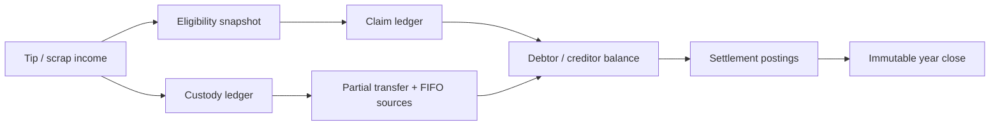

<div align="center">


# HesabYar Garage

### حساب‌یار تعمیرگاه

**An offline-first Persian Android application for workforce attendance, shared tip custody, auditable settlements, and Solar Hijri financial-year closing.**

[فارسی](README.fa.md) · [Download latest APK — after a Release is published](../../releases/latest/download/HesabYar-Garage-latest.apk) · [All releases](../../releases) · [Release/404 guide](docs/RELEASING.md) · [User guide](docs/USER_GUIDE_FA.md)

[](../../releases/latest/download/HesabYar-Garage-latest.apk)


</div>

## Why this project exists

Small auto-body and paint shops often manage attendance, customer tips, scrap-sale proceeds, and year-end settlements with notebooks or chat messages. HesabYar turns those informal records into an append-only, explainable accounting trail that still works when there is no network connection.

This is deliberately more than a CRUD application. It separates **what each employee is entitled to** from **who is currently holding the shared money**, preserves the source of every partial transfer, and makes each debtor/creditor result traceable back to the original income event.

## Product capabilities

| Area | What the application handles |
| --- | --- |
| Workforce | Editable personnel profiles, phone numbers, roles, notes, employment periods, temporary absences, and fast validated Solar Hijri date entry |
| Eligibility | Per-person shared-income participation, configurable absence grace days, and an immutable decision snapshot for every employee at every event |
| Income | Customer tips and scrap-sale proceeds with explicit cash, card-transfer, or POS receipt and optional transaction details |
| Custody | Partial or full money transfers between people with an explicit method and FIFO source allocation |
| Settlement | Live debtor/creditor balances, minimal suggestions, internal offsets, and real cash/card-transfer payments |
| History | Per-person/per-event audit trails, flexible append-only correction, and password-protected audited deletion of income, transfer, and settlement records |
| Financial years | Final Solar Hijri year close, read-only historical years, and controlled remainder rollover |
| Resilience | Fully offline Room database, optional local app/password/device lock, and password-encrypted portable backups through Android's Storage Access Framework |

## Accounting rules and invariants

- Money is stored as integer **Tomans** using `Long`; floating-point arithmetic is never used.
- Employment dates are inclusive and a return date counts as present.
- The absence grace period is configurable from 0 to 365 days and defaults to 14; a return date counts as present.
- Each employee can be excluded from future tip and scrap shares while remaining able to receive, hold, and transfer shared money.
- Eligibility snapshots are immutable after an income event is posted.
- Claim postings, custody postings, and settlement payments are separate ledgers.
- Partial custody transfers retain FIFO links to their original tip or scrap-sale events.
- Transaction correction never overwrites history: the original is reversed, opposite postings cancel it, and one audited replacement is linked to it. Correcting an older income atomically replays the affected newer income suffix while preserving frozen eligibility decisions and all source/remainder invariants.
- Transaction deletion is an audited financial reversal, not a physical row removal. The inactive record and deletion reason remain visible in history while its effect is excluded from active accounting.
- POS is an offline income-receipt classification only; it does not connect to a terminal, bank, or payment network.
- The sum of claims and the sum of custody remain balanced after income, transfer, and settlement operations.
- A financial year can close only after its end, after claims are settled, and after a final verified backup.



## Privacy and security

- The manifest requests **no Internet permission**.
- App locking is optional and disabled by default. Password/recovery plaintext is not stored; salted PBKDF2 verifiers and persistent attempt throttling stay in a separate device-local DataStore excluded from financial backups.
- Every transaction deletion requires the exact app password. If no app password is configured, the deletion action directs the user to enable the optional app lock first; device authentication and an already-unlocked session do not replace this confirmation.
- Optional fingerprint/face/device-credential unlock uses Android's system `BiometricPrompt`; the app receives only the result and never biometric templates, device PINs, patterns, or passwords.
- Protected content is not composed until security state is loaded and the current process session is unlocked; Android Recents previews are suppressed while locking is enabled.
- Full card numbers are encrypted at rest with AES-GCM keys held by Android Keystore.
- Card numbers are masked by default and revealed only on explicit user action.
- Portable backups use password-based key derivation, AES-GCM authenticated encryption, and SHA-256 integrity checks.
- Restores are transactional and create a local pre-restore safety copy.
- No Firebase, analytics SDK, advertising SDK, cloud account, or remote API is included.

## Architecture

HesabYar follows a pragmatic layered architecture built around an append-only accounting domain:

```text
UI (Compose / Material 3 / RTL)
        ↓ StateFlow + commands
Application state (ViewModel)
        ↓
Domain engines (eligibility + accounting invariants)
        ↓
Repository transactions
        ↓
Room database + DataStore + Android Keystore + SAF backup
```

Core technologies:

- Kotlin 2.3 and Coroutines/Flow
- Jetpack Compose and Material 3
- Room with exported schema and transactional repositories
- Preferences DataStore
- AndroidX BiometricPrompt and PBKDF2 app-access verifiers
- Android Keystore and Storage Access Framework
- Gradle 8.13, AGP 8.13, min SDK 26, target/compile SDK 36

## Quality evidence

- JVM coverage includes configurable eligibility boundaries, accounting invariants, flexible income-suffix correction, app-lock state and recovery-code visibility, deletion retry timing, navigation planning, movement-time parsing, Jalali input/conversion, card validation, backup cryptography, and schema contracts.
- Android instrumentation coverage includes Room migrations 1→4, 2→4, and 3→4; a real Room/DataStore/Keystore stack; exact-password transaction deletion and persistent throttling; backup schemas 1..6 including legacy fixtures; POS income; atomic correction/deletion rollback and replay; correction-safe annual-close snapshots; RTL controls; dashboard scrolling; Persian date input; and privacy acceptance.
- Password-encrypted backup → database wipe → full restore tested on Android 15
- Partial custody transfer and balanced claim/custody totals tested on Android 15
- `lintDebug` passes without errors
- Version 1.4.1 local evidence: 47 JVM tests and 35 connected Android tests pass; the exact local permanent-signed APK was signature/alignment/permission verified and installed in place over exact 1.4.0 while preserving synthetic personnel, balances, and history. Protected-workflow provenance, VirusTotal, certified-device Play Protect, and public publication remain separate and pending.
- Universal APK contains `arm64-v8a`, `armeabi-v7a`, `x86`, and `x86_64`

See the full [test report](docs/TEST_REPORT.md) and the pending versioned [1.4.1 release record](release/v1.4.1/RELEASE_RECORD.md).

## Download and install

[**Download the latest APK directly from GitHub Releases**](../../releases/latest/download/HesabYar-Garage-latest.apk)

The stable link works only after GitHub has a published Release marked as latest and that Release contains an asset named exactly `HesabYar-Garage-latest.apk`. A local tag, a pushed `main` branch, or a successful Android CI run does not create this download. If the link returns 404, inspect [all Releases](../../releases) and follow the [release and 404 recovery guide](docs/RELEASING.md#رفع-خطای-فعلی-۴۰۴-دانلود).

Once published, Android may ask you to allow installation from your browser or file manager. The application supports Android 8.0 and newer.

For Persian 1.4.1 installation and data-preservation instructions, see [release/v1.4.1/INSTALL_FA.md](release/v1.4.1/INSTALL_FA.md). No 1.4.1 public APK is authorized until its exact-file release record is complete.

## Build from source

Requirements:

- JDK 17
- Android SDK 36
- Git

```bash
git clone <repository-url>
cd hesabyar-garage-android
./gradlew testDebugUnitTest lintDebug assembleDebugAndroidTest assembleRelease
```

On Windows PowerShell, use `./gradlew.bat` instead of `./gradlew`.

With permanent signing configured, the APK is generated at `app/build/outputs/apk/release/app-release.apk`; without it, `assembleRelease` intentionally produces `app-release-unsigned.apk`. A distributable artifact must be built with the protected `assemblePublicRelease` task, use the same securely backed-up permanent private key for every version, and match the pinned certificate SHA-256 fingerprint. Signing keys and credentials must never be committed.

## Repository documentation

- [Persian user guide](docs/USER_GUIDE_FA.md)
- [Accounting model and invariants](docs/ACCOUNTING_MODEL_FA.md)
- [Test report](docs/TEST_REPORT.md)
- [Release process](docs/RELEASING.md)
- [Cafe Bazaar release guide (Persian)](docs/CAFE_BAZAAR_RELEASE_FA.md)
- [Privacy policy (Persian)](docs/PRIVACY_POLICY_FA.md)
- [GitHub Releases](../../releases)
- [Contributing guide](CONTRIBUTING.md)
- [Security policy](SECURITY.md)
- [Changelog](CHANGELOG.md)

## Contributing

Issues and pull requests are welcome. Please read [CONTRIBUTING.md](CONTRIBUTING.md) before making a change. Financial rules require tests for every boundary or ledger mutation.

## License

Released under the [MIT License](LICENSE).

## Author

Designed and developed by **Peyman Arjmand** — [email](mailto:peymanarjmand308@gmail.com), [Bale](https://ble.ir/peyman_arjmand), [Telegram](https://t.me/Peymanarjmand77).
