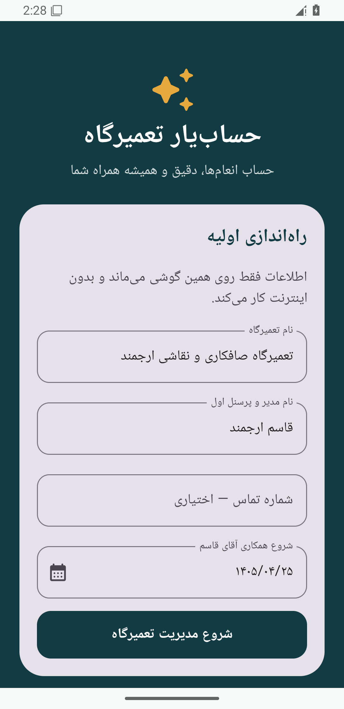
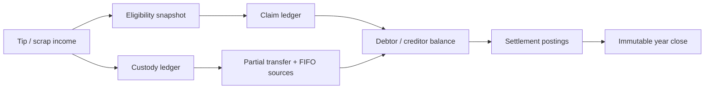

<div align="center">



# HesabYar Garage

### حساب‌یار تعمیرگاه

**An offline-first Persian Android application for workforce attendance, shared tip custody, auditable settlements, and Solar Hijri financial-year closing.**

[فارسی](README.fa.md) · [Download latest APK](../../releases/latest/download/HesabYar-Garage-latest.apk) · [User guide](docs/USER_GUIDE_FA.md) · [Accounting model](docs/ACCOUNTING_MODEL_FA.md)

[](../../releases/latest/download/HesabYar-Garage-latest.apk)


</div>

## Why this project exists

Small auto-body and paint shops often manage attendance, customer tips, scrap-sale proceeds, and year-end settlements with notebooks or chat messages. HesabYar turns those informal records into an append-only, explainable accounting trail that still works when there is no network connection.

This is deliberately more than a CRUD application. It separates **what each employee is entitled to** from **who is currently holding the shared money**, preserves the source of every partial transfer, and makes each debtor/creditor result traceable back to the original income event.

## Product capabilities

| Area | What the application handles |
| --- | --- |
| Workforce | Personnel profiles, phone numbers, roles, multiple employment periods, temporary absences, and inclusive start/end dates |
| Eligibility | Equal sharing with an immutable decision snapshot for every employee at every income event |
| Income | Customer tips and scrap-sale proceeds, received as cash or into a selected bank card |
| Custody | Partial or full money transfers between people and cash/card accounts with FIFO source allocation |
| Settlement | Live debtor/creditor balances, minimal payment suggestions, internal offsets, and real payments |
| History | Per-person and per-event audit trails, including why somebody did or did not receive a share |
| Financial years | Final Solar Hijri year close, read-only historical years, and controlled remainder rollover |
| Resilience | Fully offline Room database and password-encrypted portable backups through Android's Storage Access Framework |

## Accounting rules and invariants

- Money is stored as integer **Tomans** using `Long`; floating-point arithmetic is never used.
- Employment dates are inclusive and a return date counts as present.
- Absence days 1–14 remain eligible; day 15 onward is ineligible until return.
- Eligibility snapshots are immutable after an income event is posted.
- Claim postings, custody postings, and settlement payments are separate ledgers.
- Partial custody transfers retain FIFO links to their original tip or scrap-sale events.
- The sum of claims and the sum of custody remain balanced after income, transfer, and settlement operations.
- A financial year can close only after its end, after claims are settled, and after a final verified backup.



## Privacy and security

- The manifest requests **no Internet permission**.
- Full card numbers are encrypted at rest with AES-GCM keys held by Android Keystore.
- Card numbers are masked by default and revealed only on explicit user action.
- Portable backups use password-based key derivation, AES-GCM authenticated encryption, and SHA-256 integrity checks.
- Restores are transactional and create a local pre-restore safety copy.
- No Firebase, analytics SDK, advertising SDK, cloud account, or remote API is included.

## Architecture

HesabYar follows a pragmatic layered architecture built around an append-only accounting domain:

```text
UI (Compose / Material 3 / RTL)
        ↓ StateFlow + commands
Application state (ViewModel)
        ↓
Domain engines (eligibility + accounting invariants)
        ↓
Repository transactions
        ↓
Room database + DataStore + Android Keystore + SAF backup
```

Core technologies:

- Kotlin 2.3 and Coroutines/Flow
- Jetpack Compose and Material 3
- Room with exported schema and transactional repositories
- Preferences DataStore
- Android Keystore and Storage Access Framework
- Gradle 8.13, AGP 8.13, min SDK 26, target/compile SDK 36

## Quality evidence

- 19 JVM tests across eligibility boundaries, accounting invariants, Jalali conversion, card validation, backup cryptography, and backup schema contracts
- 2 Android instrumentation tests using a real in-memory Room database and Android Keystore
- Password-encrypted backup → database wipe → full restore tested on Android 15
- Partial custody transfer and balanced claim/custody totals tested on Android 15
- `lintDebug` passes without errors
- Minified Release APK verified, installed, and cold-started on Android 15
- Universal APK contains `arm64-v8a`, `armeabi-v7a`, `x86`, and `x86_64`

See the full [test report](docs/TEST_REPORT.md) and [delivery audit](docs/COMPLETION_AUDIT.md).

## Download and install

[**Download the latest APK directly from GitHub Releases**](../../releases/latest/download/HesabYar-Garage-latest.apk)

The stable link above always targets the asset named `HesabYar-Garage-latest.apk` in the latest published release. Android may ask you to allow installation from your browser or file manager. The application supports Android 8.0 and newer.

For Persian installation instructions, see [release/راهنمای-نصب.md](release/راهنمای-نصب.md).

## Build from source

Requirements:

- JDK 17
- Android SDK 36
- Git

```bash
git clone <repository-url>
cd hesabyar-garage-android
./gradlew testDebugUnitTest lintDebug assembleRelease
```

On Windows PowerShell, use `./gradlew.bat` instead of `./gradlew`.

The APK is generated at `app/build/outputs/apk/release/app-release.apk`. Production releases should always be signed with the same private release key; signing keys and credentials must never be committed.

## Repository documentation

- [Persian user guide](docs/USER_GUIDE_FA.md)
- [Accounting model and invariants](docs/ACCOUNTING_MODEL_FA.md)
- [Test report](docs/TEST_REPORT.md)
- [Release process](docs/RELEASING.md)
- [Contributing guide](CONTRIBUTING.md)
- [Security policy](SECURITY.md)
- [Changelog](CHANGELOG.md)

## Contributing

Issues and pull requests are welcome. Please read [CONTRIBUTING.md](CONTRIBUTING.md) before making a change. Financial rules require tests for every boundary or ledger mutation.

## License

Released under the [MIT License](LICENSE).

## Author

Designed and developed by **Peyman Arjmand**.
